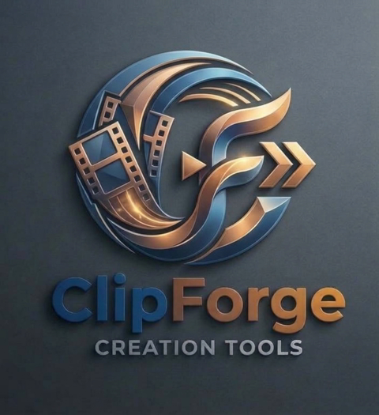

<p align="center"></p>

# ClipForge Studio

Desktop tool for working with segmented video recordings (dash cams, phones, action cameras, screen recorders):

- **Steps in any combination** — tick Merge, Speed up and/or Compress and start them in one go, or run them one by one.
- **Merge** clip segments losslessly (stream copy) — per continuous session or all selected clips into one file.
- **Speed up** videos 1×–100× (e.g. 2× halves the length); the frame rate is kept and the original sound keeps its pitch.
- **Hide licence plates and faces** automatically before sharing (blurred; detection models downloaded on first start).
- **Re-score audio** — keep, remove, or replace with a looping music playlist (seamless crossfade at every restart, optional fade-out, volume, optional quiet mix of the original sound) — for merging and compression.
- **Compress** large recordings with AV1/HEVC (NVENC, SVT-AV1, x265) in resumable segments; the output grows while encoding and can be watched, pause/stop/crash lose at most the segments in progress.
- **Telemetry** — reads GPS/time data embedded by dash cams (SigmaStar), GoPro (GPMF), DJI (.SRT) and phones; route preview, speed chart, GPX/CSV export, OpenStreetMap view.
- **Date/time stamp** burned into compressed videos; **folder watching** picks up clips while they are still being copied.

All heavy lifting is done by [FFmpeg](https://ffmpeg.org); ClipForge is the workflow and UI around it.

## Requirements

- JDK 26
- FFmpeg (tested with 9.0; `ffmpeg` and `ffprobe` on `PATH` or chosen under *Tools ▸ FFmpeg location*)
- Optional: NVIDIA GPU with NVENC for hardware encoding

## Build & run

```sh
./mvnw verify                                  # build + tests
./mvnw -pl clipforge-desktop javafx:run        # start the desktop app
```

On Windows use `mvnw.cmd`.

### Packaging

```sh
powershell -ExecutionPolicy Bypass -File packaging\package.ps1   # Windows app image in dist/
packaging/package.sh                                           # Linux / macOS
```

The app image contains its own Java runtime (~100 MB). FFmpeg is not bundled: on Windows ClipForge downloads a pinned FFmpeg build on first start if none is
installed (or choose its folder under *Tools ▸ FFmpeg location*). `-Type msi` / `exe` installers additionally need the WiX Toolset.

## Project layout

| Module | Purpose |
|---|---|
| `clipforge-core` | UI-independent services: scanning, FFmpeg jobs, merging, project files, i18n bundles |
| `clipforge-desktop` | JavaFX + AtlantaFX desktop UI |

A future web front-end can depend on `clipforge-core` only.

## Languages

The UI is fully translatable. See [CONTRIBUTING.md](CONTRIBUTING.md#adding-a-language).

## Documentation

- [Implementation plan](docs/PLAN.md)
- [Pause & recovery design](docs/RECOVERY.md)
- [End-to-end test](docs/E2E.md)

## License

[MIT](LICENSE)
